# Speaker-Preserving Speech-to-Singing Synthesis — Project Report

Complete account of the domain, what has been built, why, how it runs, and what it achieves.
Status as of 2026-10-11.

**How to read this document**

- **Part I — Domain background** explains the speech science, signal processing and AI the project
  rests on, from first principles. Each topic ends with **"In this project"**, linking it to our code
  and numbers.
- **Part II — The project** describes what was built, the infrastructure, the results and the next steps.

| Part I — Domain background | Part II — The project |
|---|---|
| B1. How humans produce speech and singing | 1. Objective |
| B2. Phonetics and prosody | 2. Dataset |
| B3. Digital audio | 3. System architecture + **input → output walkthrough** |
| B4. Time–frequency analysis: STFT and spectrograms | 4. Infrastructure |
| B5. The mel scale and mel spectrograms | 5. Repository layout |
| B6. Cepstrum, MFCC and MCD | 6. Phase 1 — features |
| B7. Pitch (F0) and how it is estimated | 7. WORLD baseline |
| B8. Vocoders: classical (WORLD) and neural (HiFi-GAN, NSF) | 8. Phase 2 — duration model |
| B9. Speech and singing synthesis systems | 9. Phase 3 — acoustic model |
| B10. Machine learning foundations | 10. Results (incl. ablations, GAN, regularisation, **Exp 2: a different melody**) |
| B11. Sequence models: Transformer and Conformer | 11. Deliverables |
| B12. Self-supervised speech representations (HuBERT) | 12. How to reproduce |
| B13. Speaker embeddings (ECAPA-TDNN) | 13. Commit history |
| B14. Generative models and adversarial training | 14. Limitations and next steps |
| B15. Hybrid signal-processing + neural systems | |
| B16. Evaluating synthesized speech and singing | |
| B17. Glossary | 15. **Figures explained** |

---

# Part I — Domain background

## B1. How humans produce speech and singing

### The source–filter model

The most important idea in speech processing: a voice is a **source** shaped by a **filter**.

```
 lungs ──► vocal folds ──────────► vocal tract (throat, mouth, nose, tongue, lips) ──► sound
           SOURCE                  FILTER
           buzz at a rate F0       resonances (formants) shape the spectrum
           (or noise, for s/f/sh)  → decides WHICH vowel/consonant and WHOSE voice
```

- **Source — the vocal folds.** Air from the lungs makes the vocal folds vibrate. Each vibration
  releases a pulse of air, and the pulse rate is the **fundamental frequency, F0** — roughly 85–180 Hz
  for typical male speech and 165–255 Hz for female speech, and wider in singing. A vibrating source
  produces energy at F0 and its **harmonics** (2·F0, 3·F0, …). Sounds without vibration ("s", "f", "sh")
  have a **noise** source instead; these are **unvoiced**.
- **Filter — the vocal tract.** The tube from the vocal folds to the lips resonates at certain
  frequencies called **formants** (F1, F2, F3…). Moving the tongue and lips changes the formants, and
  that is what makes "ee" different from "aa". The tract's length and shape also differ between people,
  which is a large part of **why voices sound different**.
- **The key consequence:** pitch (source) and timbre/vowel (filter) are roughly **independent**. That is
  why we can change the melody of a voice while keeping its identity — the core trick of this project.

### Speech vs. singing

| Aspect | Speech | Singing |
|---|---|---|
| Pitch | glides freely, carries intonation | held on discrete notes; vibrato (~5–7 Hz wobble) |
| Timing | syllable-timed, fast | vowels stretched to note lengths; consonants stay short |
| Loudness / breath | conversational | sustained, more breath support |
| Spectrum | normal formants | trained singers add a "singer's formant" (~3 kHz) and adjust vowels |

**In this project:** the sung recordings are about 2.1× longer than the spoken ones (114 vs 54 min), and
vowels stretch 2.3–4.4× (`figures/duration_ratio_phones.png`), while consonants barely change.

---

## B2. Phonetics and prosody

- **Phoneme / phone:** the smallest sound unit that distinguishes words ("cat" = /k/ /æ/ /t/). The
  corpus uses **ARPAbet** symbols (`aa`, `iy`, `k`, `sh`, …) — 41 types here, including silences.
- **Vowels vs. consonants:** vowels are voiced, open sounds carried by formants; consonants are
  constrictions (stops like `k`, fricatives like `s`, nasals like `m`).
- **Forced alignment:** finding *when* each phone starts and ends in a recording. NUS-48E provides
  manual alignments, so we did not need an aligner.
- **Prosody:** the "music" of speech — **pitch** (F0 contour), **duration** (timing) and **loudness**.
  Speech-to-singing is essentially **prosody transformation**: keep the words and the voice, replace
  pitch and duration with those dictated by the melody.

**In this project:** the phone alignments give exact spoken and sung durations for every phone (the two
sequences are 1:1), which supervise the duration model (Phase 2) and drive time-warping (Phase 3).

---

## B3. Digital audio

- **Sampling:** a microphone signal is measured **sr** times per second. **Nyquist theorem:** you can
  represent frequencies only up to **sr/2**. 44.1 kHz (CD quality) covers up to 22 kHz — all of human
  hearing; 16 kHz covers up to 8 kHz — enough for intelligibility, so most speech models use it.
- **Bit depth:** precision of each sample (16-bit = 65,536 levels; 24-bit is finer). WAV stores raw PCM
  samples.
- **Resampling:** converting between sample rates with an anti-aliasing filter. Models trained at
  16 kHz (HuBERT, ECAPA, CREPE) must receive 16 kHz input.
- **Lossless compression (FLAC):** smaller files with bit-exact reconstruction.

**In this project:** the corpus is 44.1 kHz (KENN's spoken files are 48 kHz); HuBERT and ECAPA get 16 kHz
input — feeding ECAPA 44.1 kHz was one of the bugs fixed. FLAC cut the transfer to the GPU server from
1,537 MB to 658 MB with bit-exact decoding.

---

## B4. Time–frequency analysis: STFT and spectrograms

A waveform shows amplitude over time, but we hear **frequencies**. Speech changes every few
milliseconds, so we analyse it in short pieces:

1. **Framing:** cut the signal into short overlapping **frames** (window length, e.g. 2048 samples ≈ 46 ms),
   advancing by a **hop** (e.g. 512 samples ≈ 11.6 ms).
2. **Windowing:** taper each frame (Hann window) to avoid edge artefacts.
3. **FFT:** the Fourier transform turns each frame into its frequency content (magnitude + phase).

This is the **Short-Time Fourier Transform (STFT)**. Plotting magnitude over time gives a
**spectrogram**: horizontal lines are harmonics of F0, broad bright bands are formants, and fuzzy
vertical patches are noisy consonants.

**Time–frequency trade-off:** longer windows give sharper frequency resolution but blur fast changes.

**Phase:** the STFT also has phase, which is hard to model. Most systems predict only magnitudes and let a
**vocoder** reconstruct the waveform (B8). The classical method for this is **Griffin–Lim**, which
iteratively estimates the phase.

**In this project:** the acoustic model works on STFT magnitudes with n_fft = 2048 and hop = 512 at 44.1 kHz
→ **86.1 frames per second**. `features/mel_invert.py` uses Griffin–Lim only as an early audibility check.

---

## B5. The mel scale and mel spectrograms

Human pitch perception is roughly **logarithmic**: 100→200 Hz sounds like the same step as 1000→2000 Hz.
The **mel scale** models this:

```
mel(f) = 2595 · log10(1 + f / 700)
```

A **mel filterbank** groups the linear FFT bins into bands that are narrow at low frequencies and wide at
high ones. Then we take the **log** (loudness perception is also logarithmic):

```
waveform → STFT magnitude → mel filterbank (e.g. 128 bands) → log  =  log-mel spectrogram
```

The log-mel spectrogram is the standard intermediate representation of modern TTS and singing synthesis:
compact, perceptually meaningful, and easy for neural networks to predict.

**In this project:** the acoustic model predicts a **128-band log-mel (40 Hz–16 kHz)** — exactly the
format the pretrained vocoder was trained on (`features/vocoder.py`, cache `vmel/`).

---

## B6. Cepstrum, MFCC and MCD

- **Cepstrum:** the inverse Fourier (or DCT) transform of the **log** spectrum. Because log turns
  source × filter into source + filter, the cepstrum separates them: **low coefficients describe the
  smooth spectral envelope (vocal tract/timbre)**, high ones the fine harmonic structure (pitch).
- **MFCC (mel-frequency cepstral coefficients):** the DCT of a log-mel spectrum; the first ~13–25
  coefficients compactly describe timbre and phonetic content. They were the dominant speech feature
  for decades.
- **MCD (mel-cepstral distortion):** the standard objective metric for synthesis quality — the distance
  between the mel-cepstra of generated and reference audio, in dB:

```
MCD = (10 / ln 10) · sqrt( 2 · Σ_d (c_d − ĉ_d)² )      averaged over frames, d = 1..24 (c0 = energy excluded)
```

Lower is better. MCD needs the two signals to be **time-aligned** (here they share the melody's timeline;
published work often uses DTW alignment).

**In this project:** `scripts/evaluate.py` computes an MFCC-style MCD on c1–c24 over non-silent frames.
It ranks our systems consistently, but its absolute values are not directly comparable to SPTK-based
MCD in papers.

---

## B7. Pitch (F0) and how it is estimated

### Units

| Unit | Formula | Use |
|---|---|---|
| Hz | vibrations per second | raw F0 |
| MIDI note | `69 + 12·log2(f / 440)` (A4 = 440 Hz = 69) | musical notes; 1 unit = 1 semitone |
| cents | `1200·log2(f1 / f2)` (100 cents = 1 semitone) | pitch error independent of voice range |

### Estimation methods

| Method | Idea | Notes |
|---|---|---|
| Autocorrelation / YIN | a periodic signal matches a copy of itself shifted by one period | classic, fast; octave errors |
| **Harvest** (WORLD) | many band-pass filters + candidate tracking over time | robust on clean singing; 0 Hz for unvoiced |
| **CREPE** | a CNN trained to classify each 64 ms frame into 360 pitch bins (20-cent resolution) | very accurate when well matched, but the "tiny" model is weak |

Common failure modes are **octave errors** (reporting 2× or ½× the true F0) and **voicing errors**
(calling noise voiced, or vice versa).

**In this project:** CREPE-tiny produced near-zero confidence and ~2-octave errors on about half the singers,
so only 54% of sung vowels got a note. Switching to **Harvest** raised coverage to 99.8% (`features/world_f0.py`).
Pitch accuracy is reported as F0 RMSE (Hz and cents) and F0 correlation.

---

## B8. Vocoders: classical and neural

A **vocoder** (voice + encoder) turns compact acoustic features back into a waveform.

### Classical: WORLD (source–filter analysis/synthesis)

WORLD decomposes a voice into three parameters, every 5 ms:

| Parameter | Algorithm | Meaning |
|---|---|---|
| F0 | Harvest | the source's pitch |
| Spectral envelope | CheapTrick | the filter (timbre, formants), independent of pitch |
| Aperiodicity | D4C | how noisy vs. harmonic each band is |

Because source and filter are separate, you can **change F0 and stretch time while keeping the envelope**
— exactly what a classical speech-to-singing converter needs. The cost is a slightly buzzy, "vocoded" sound.

### Neural vocoders

- **WaveNet (2016):** generates audio sample by sample — high quality but very slow.
- **HiFi-GAN (2020):** a convolutional generator **upsamples** a mel spectrogram to a waveform in one pass,
  trained with **adversarial losses** (B14): multi-period discriminators look at periodic structure and
  multi-scale discriminators at different resolutions. It is fast and near-natural.
- **NSF — Neural Source-Filter (2019):** adds an explicit **sine-wave excitation at F0** inside the network.
  The vocoder is told the pitch directly, which makes it robust for singing's wide, precise pitch range.
- **NSF-HiFiGAN** combines both, and is the standard vocoder of open singing-synthesis systems (DiffSinger).

**In this project:** WORLD powers the classical baseline (`baselines/world_baseline.py`). The pretrained OpenVPI
**NSF-HiFiGAN** (44.1 kHz, 128 mels) turns predicted mels + melody F0 into audio. Copy-synthesis — analysing
real singing and resynthesizing it — scores MCD ≈ 1.0 dB, which is the vocoder's quality ceiling.

---

## B9. Speech and singing synthesis systems

### The modern pipeline

```
linguistic input ──► [duration model] ──► [acoustic model] ──► mel spectrogram ──► [vocoder] ──► audio
(phones, notes,        how long each       what each frame
 speaker, …)           unit lasts          sounds like
```

| Area | Input → output | Examples |
|---|---|---|
| **TTS** (text-to-speech) | text → speech | Tacotron 2, FastSpeech 2, VITS |
| **SVS** (singing voice synthesis) | lyrics + musical score → singing | Sinsy, XiaoiceSing, DiffSinger, VISinger |
| **Voice conversion** | speech of A → speech of B | AutoVC, so-vits-svc |
| **Speech-to-singing (STS)** | speech + melody → singing, same voice | template-based STS, SpeaKing — **this project** |

### Key ideas we use

- **Duration modelling (FastSpeech):** non-autoregressive TTS predicts how many frames each phone lasts,
  then **expands** (repeats or warps) phone-level features to frame level — the "length regulator". Our Phase 2
  is a FastSpeech-style duration predictor, additionally conditioned on musical notes.
- **Content–speaker–pitch disentanglement:** represent *what* is said, *who* says it and *how it is pitched*
  separately, then recombine them freely. This is the conceptual core of voice conversion and of this project.
- **Oracle vs. predicted:** "oracle" experiments use ground-truth durations to isolate the acoustic model;
  "predicted" ones run the whole system automatically.

---

## B10. Machine learning foundations

### Supervised learning and generalization

A model learns a function from input→target pairs by minimizing a **loss** on the **training set**. What
matters is performance on **unseen data**:

- **Validation set:** used to pick checkpoints and settings.
- **Test set:** touched only for final numbers.
- **Speaker-disjoint split:** validation and test speakers never appear in training, so the model must
  generalize to **new voices** — the realistic and much harder setting.

### Overfitting

When the training loss keeps falling but the validation loss rises, the model is **memorizing** the
training set. It is common with small data. Remedies:

- **Early stopping:** keep the checkpoint with the best validation loss, and stop when it stops improving.
- **Regularization:** dropout (randomly zeroing activations), weight decay, data augmentation.
- Smaller models, or more data.

### Training mechanics

| Concept | Meaning | Our setting |
|---|---|---|
| Embedding | learnable vector per discrete symbol (phone, pitch bin) | phone and pitch embeddings |
| Loss | what is minimized | L1 on log-mel; MSE on log-duration |
| Optimizer | how weights are updated from gradients | AdamW (Adam + decoupled weight decay) |
| Learning-rate schedule | warm up, then decay the step size | OneCycle |
| Gradient clipping | caps update size for stability | 1.0 |
| Mixed precision | 16-bit (bf16) math for speed and memory | bf16 autocast |
| Batch / crops | train on random 512-frame windows of songs | batch 32 |

### Why L1/L2 losses blur outputs (over-smoothing)

For a given input there are many plausible outputs (fine details of breath, noise, exact harmonic shape).
An L2 loss is minimized by their **mean** and an L1 loss by their **median**, and averaging plausible
spectrograms gives a **blurry** one. That is why regression-trained acoustic models sound muffled, and why
adversarial or diffusion models (B14) are used to restore detail.

**In this project:** both Conformers overfit early (best validation at steps 9,000 and 3,000) with only 40
training songs, so validation-based checkpointing and early stopping are essential. The generated mels are
visibly over-smoothed compared with real singing.

---

## B11. Sequence models: Transformer and Conformer

- **RNNs** (LSTMs) process sequences step by step — slow to train, and they struggle with long context.
- **Transformer (2017):** **self-attention** lets every frame look at every other frame and decide how
  relevant each is:

  ```
  Attention(Q, K, V) = softmax(Q·Kᵀ / √d) · V
  ```

  Queries, keys and values are learned projections of the inputs. **Multi-head** attention runs several of
  these in parallel. It is parallel and global, but attention alone has no notion of order, so positional
  information must be added.
- **Conformer (2020):** designed for speech. Each block combines:
  - **self-attention** for global context (phrases, the whole note);
  - a **depthwise convolution** module for local patterns (formant transitions, onsets);
  - two half-step **feed-forward** layers ("macaron" style).

  It became the standard encoder for speech recognition and is strong for acoustic modelling.

**In this project:**
- **Duration model:** a 2-layer Transformer encoder over phone sequences, with sinusoidal positions.
- **Acoustic model:** a 6-layer `torchaudio` Conformer (d = 256, 4 heads, conv kernel 31). This
  implementation has no explicit positional encoding; order information comes from the convolutions.

---

## B12. Self-supervised speech representations (HuBERT)

**Self-supervised learning (SSL)** pre-trains a model on huge amounts of *unlabelled* audio by inventing a
prediction task from the audio itself; the learned features then transfer to other tasks.

**HuBERT** (Hidden-Unit BERT, 2021):

1. A CNN turns 16 kHz audio into frames every 20 ms (**50 Hz**).
2. Some frames are **masked**, and a 12-layer Transformer must predict *cluster labels* of the masked frames.
   The labels come from k-means on MFCCs, then on HuBERT's own features in a second round — like BERT's
   masked-word prediction, but for sound.
3. To solve this, the model must learn the structure of speech: phones, words, context.

**What its layers contain:** early layers stay close to the acoustics (including speaker and recording
characteristics), **middle-to-late layers are strongly phonetic** — they encode *what* is said while
partly discarding *who* says it — and the final layers are specialised to the pre-training targets. This
is why HuBERT features work as a modern replacement for phonetic posteriorgrams (PPGs) in voice conversion.

**In this project:** HuBERT-base, **layer 9** (768-d, 50 Hz), extracted from the *spoken* lyrics, is the
**content** input. It is time-warped phone by phone onto the singing timeline.

---

## B13. Speaker embeddings (ECAPA-TDNN)

**Speaker verification** asks "are these two recordings the same person?". Models trained for it compress a
whole utterance into a fixed **speaker embedding** (a "voiceprint").

- **x-vectors:** time-delay neural networks (TDNN, 1-D dilated convolutions over frames) + statistics
  pooling (mean and standard deviation over time) → embedding.
- **ECAPA-TDNN (2020):** improves x-vectors with Res2Net blocks with squeeze-and-excitation (channel
  attention), multi-layer feature aggregation, and **attentive statistics pooling** (weights informative
  frames more). Trained on VoxCeleb (thousands of speakers) with an angular-margin softmax so that
  embeddings of the same speaker cluster tightly.
- **Comparison** uses **cosine similarity** (1 = identical direction, ~0 = unrelated).

**In this project:**
- **Conditioning and evaluation:** the 192-d SpeechBrain ECAPA embedding of the spoken utterance
  conditions the acoustic model and is also the speaker-similarity metric.
- **Separation:** after the 16 kHz fix, same-speaker similarity is 0.93 and cross-speaker 0.14.
- **The limit:** the embedding *describes* a voice, but a generator trained on only **10 speakers** cannot
  learn to *produce* a new voice from it. That is why the pure Conformer's speaker similarity collapsed
  to ≈ 0 (B15).

---

## B14. Generative models and adversarial training

- **GAN (Generative Adversarial Network):** a **generator** produces samples, and a **discriminator**
  learns to tell them from real ones. The generator is trained to fool it. Because the discriminator
  punishes anything that does not look real — including blur — GANs produce sharp, detailed output.
  HiFi-GAN is a GAN.
- **Diffusion models:** learn to denoise step by step from pure noise. DiffSinger uses one to generate
  detailed mels, at the cost of slower inference.
- **Why it matters here:** our acoustic models are trained with L1 only, hence over-smoothing (B10).
  Adding a mel discriminator (the "optional adversarial loss" in `approach.md`) is the standard next step.

---

## B15. Hybrid signal-processing + neural systems

Classical DSP brings strong, correct **structure** (source–filter separation, exact pitch control);
neural networks bring **realism** learned from data. With little data, combining them is often better
than either alone:

- **Residual learning:** instead of predicting the output from scratch, predict a **correction** to a good
  initial guess. Easier to learn, and it keeps what the guess already gets right.
- **Zero initialization:** if the correction layer starts at zero, the model begins *exactly* at the
  classical output and can only improve from there.

**In this project:** the **hybrid Conformer** predicts `WORLD mel + correction`. WORLD already supplies the
speaker's timbre, the melody and the timing, so the network only learns what makes it sound *sung*. On the
unseen test speaker this raised speaker similarity from 0.00 (pure neural) to 0.35, gave the best pitch
accuracy (13.3 Hz error), and still beat WORLD on MCD (4.12 vs 4.32).

---

## B16. Evaluating synthesized speech and singing

### Objective metrics

| Metric | Measures | Better |
|---|---|---|
| MCD (dB) | spectral/timbre distance to the reference | lower |
| F0 RMSE (Hz, cents) | pitch error on frames voiced in both | lower |
| F0 correlation | whether the melody contour shape is followed | higher (max 1) |
| Speaker cosine similarity | whether it sounds like the target speaker (ECAPA) | higher |
| Duration MAE (ms) | timing error per phone | lower |

### Subjective evaluation

Humans remain the final judges:

- **MOS:** 1–5 ratings of naturalness or similarity.
- **MUSHRA:** side-by-side rating of several systems against a hidden reference and anchor.

`approach.md` plans ≥ 10 listeners rating naturalness, speaker similarity and melody adherence.

### Interpretation caveats (relevant to our results)

- **Speaker similarity:** we compare against the speaker's *spoken* voice, and singing naturally shifts the
  embedding — real singing scores only 0.44. WORLD's 0.66 is high because its output keeps the *speech*
  timbre, not because it sounds more like that person *singing*.
- **MCD:** frame-aligned MCD penalizes timing errors, so systems using predicted durations score worse
  partly for timing, not only timbre.

---

## B17. Glossary

| Term | Meaning |
|---|---|
| Aperiodicity | how noise-like (vs. harmonic) each frequency band is |
| ARPAbet | ASCII phone alphabet for English (`aa`, `iy`, `sh`, …) |
| bf16 | 16-bit floating point used for fast training |
| Cepstrum | transform of the log spectrum separating envelope from pitch structure |
| Checkpoint | saved model weights at a training step |
| Conformer | Transformer + convolution block for speech |
| Copy-synthesis | analyse real audio, then resynthesize it — a vocoder's upper bound |
| Cosine similarity | similarity of two vectors' directions (−1…1) |
| DTW | dynamic time warping: aligns two sequences of different speed |
| Embedding | learned vector representing a discrete item or a whole utterance |
| F0 | fundamental frequency — the pitch of a voiced sound |
| Formant | resonance of the vocal tract; defines vowels and timbre |
| Harmonic | integer multiple of F0 |
| Hop | step between successive analysis frames |
| HuBERT | self-supervised speech model whose middle layers encode phonetic content |
| L1 / L2 loss | mean absolute / squared error |
| Mel spectrogram | spectrogram on a perceptual frequency scale, log-compressed |
| MCD | mel-cepstral distortion — spectral distance in dB |
| NSF | neural source-filter vocoder with a sine excitation at F0 |
| Oracle | using ground-truth values for a component to isolate another |
| Overfitting | memorizing training data instead of generalizing |
| Phone / phoneme | smallest distinctive speech sound |
| Prosody | pitch, duration and loudness patterns |
| Residual | a correction added to an existing estimate |
| Speaker-disjoint | no speaker appears in more than one of train/val/test |
| STFT | short-time Fourier transform — frame-by-frame spectrum |
| SVS / TTS / VC / STS | singing synthesis / text-to-speech / voice conversion / speech-to-singing |
| Unvoiced | sound without vocal-fold vibration (s, f, sh, silence) |
| Vocoder | converts acoustic features (mel, F0) into a waveform |
| WORLD | classical vocoder: F0 + spectral envelope + aperiodicity |

---

# Part II — The project

## 1. Objective

> **Can a singing performance be generated from a person's *spoken* lyrics, preserving their voice,
> while the melody is controlled independently?**

- **Input:** a speaker reading the lyrics + a reference melody
- **Output:** the same speaker *singing* those lyrics to that melody

Most singing synthesis needs recordings of the target person singing; this project needs only their speech.

Three gaps between speech and singing have to be bridged:

| Gap | Speech | Singing |
|---|---|---|
| Timing | fast, syllable-timed | vowels stretched to note lengths (~2.3× longer here) |
| Pitch | loose, gliding | stable musical notes |
| Voice quality | speaking resonance | singing resonance, but still *that* person |

### Research questions (from `overview.md`)

| RQ | Question |
|---|---|
| RQ1 | Can self-supervised content features (HuBERT) carry the lyrics through? |
| RQ2 | Is the speaker's identity preserved? |
| RQ3 | Does the output follow the given melody? |
| RQ4 | Can sung timing be predicted from speech + melody? |

---

## 2. Dataset — NUS-48E (NUS Sung and Spoken Lyrics Corpus)

| Property | Value |
|---|---|
| Speakers | 12 (6 male, 6 female) |
| Recordings | 48 paired (spoken + sung) — 4 songs per speaker, 20 unique songs |
| Duration | ~169 min (≈54 min spoken, ≈114 min sung) |
| Audio | 44.1 kHz (except KENN's four spoken files: 48 kHz) |
| Annotations | phone-level time alignment for both spoken and sung versions |

**Split (speaker-disjoint, seed 42):** 10 train speakers (40 songs) / **JLEE** validation / **VKOW** test.
Validation and test speakers are never seen in training.

### Key findings about the data

1. **Spoken and sung phone sequences are 1:1.** All 48 pairs have the same phone count; only silence
   markers differ (`sil` ↔ `sp`). This gives the exact spoken and sung duration of every phone — the
   foundation for the duration model and for time-warping.
2. **6,858 sung `sp` phones have zero duration** — short pauses in speech that the singer does not make.
   This is correct behaviour, not an error.
3. **79 boundaries overlap** (annotation slips). Boundaries are forced monotonic when time-warping.
4. **KENN's four spoken recordings are 48 kHz** — all loading goes through a resampling loader.

---

## 3. System architecture

```
                 SPOKEN LYRICS (read/*.wav)                     REFERENCE MELODY (sung F0)
                          │                                               │
          ┌───────────────┼──────────────────┐                            │
          ▼               ▼                  ▼                            ▼
   HuBERT layer 9   ECAPA-TDNN (16 kHz)   phone annotations        WORLD Harvest F0 ─► note segments
   content, 50 Hz   speaker, 192-d              │                         │                │
          │               │                     ▼                         │                │
          │               │        ┌─────────────────────────┐            │                │
          │               │        │ PHASE 2: duration model │◄───────────┼────────────────┘
          │               │        │ 2-layer Transformer     │            │
          │               │        └───────────┬─────────────┘            │
          │               │          sung phone durations                 │
          │               │                    │                          │
          ▼               ▼                    ▼                          ▼
   ┌──────────────────────────────────────────────────────────────────────────────┐
   │ PHASE 3: Conformer acoustic model (6 layers, d=256)                           │
   │   inputs per frame (86 Hz): time-warped HuBERT + speaker + pitch + voicing    │
   │   hybrid mode: + mel of the WORLD conversion, model predicts a residual       │
   └──────────────────────────────────┬───────────────────────────────────────────┘
                                      ▼ 128-bin log-mel
                     pretrained NSF-HiFiGAN vocoder (44.1 kHz, uses F0)
                                      ▼
                                singing.wav
```


### 3.1 Input → output walkthrough: one song, end to end

This traces **VKOW_05**, a song by the *unseen test speaker*, through every stage, with the real numbers.

#### What goes in

| Input | File | Content |
|---|---|---|
| **A. Spoken lyrics** | `nus-smc-corpus_48/VKOW/read/05.wav` + `05.txt` | 54.5 s of VKOW reading the lyrics; 619 annotated phones |
| **B. Reference melody** | Harvest F0 of `sing/05.wav` | 173.5 s pitch contour at 100 Hz (17,350 frames) → 501 note segments |

In our experiments the melody comes from the real sung recording, so the output can be compared with
ground truth. At deployment it could come from any song, humming or a MIDI file (after F0 extraction).

#### Step by step

| # | Stage | What happens | Shape for VKOW_05 |
|---|---|---|---|
| 1 | **Load and resample** | speech 44.1 kHz → 16 kHz for HuBERT and ECAPA | 54.5 s audio |
| 2 | **Content (HuBERT)** | layer-9 features, one vector every 20 ms: *what* is said | (2726, 768) |
| 3 | **Speaker (ECAPA)** | one voiceprint for the whole utterance: *who* speaks | (192,) |
| 4 | **Melody** | Harvest F0 (0 Hz = unvoiced) and note segmentation (MIDI pitch, onset, length) | (17350,) + 501 notes |
| 5 | **Durations (Phase 2)** | the duration model predicts each phone's sung length from phone, spoken length, HuBERT and note; then they are rescaled to fill the melody | 619 durations: 54.5 s spoken → 152.5 s predicted → rescaled to 173.6 s (true sung: 173.6 s) |
| 6 | **Time warping** | every 86.1 Hz singing frame is mapped back to the moment of speech it belongs to (`figures/report/time_warping.png`), and HuBERT is interpolated there | (14944, 768) on the singing timeline |
| 7 | **WORLD conversion** (hybrid only) | WORLD-analyse the speech, stretch its envelope phone by phone, replace F0 with the melody, resynthesize, take the vocoder mel | (14944, 128) |
| 8 | **Acoustic model (Phase 3)** | per frame: content + speaker + pitch embedding + voicing (+ WORLD mel) → 6 Conformer layers → mel. The hybrid outputs *WORLD mel + correction*. Songs run in 512-frame chunks with 128-frame cross-fades | (14944, 128) log-mel |
| 9 | **Vocoder** | NSF-HiFiGAN: predicted mel + melody F0 → waveform; each frame becomes 512 samples | 173.5 s at 44.1 kHz |
| 10 | **Evaluation** | compare with the real `sing/05.wav`: MCD, F0 error, speaker similarity | see below |

#### What comes out — VKOW_05 scores

| System | MCD ↓ | F0 RMSE (Hz) ↓ | F0 CORR ↑ | Speaker sim ↑ |
|---|---|---|---|---|
| WORLD (real durations) | 4.14 | 16.1 | 0.899 | 0.691 |
| Pure Conformer (real durations) | 3.69 | 28.5 | 0.767 | 0.065 |
| **Hybrid (real durations)** | 3.89 | 14.5 | 0.909 | 0.396 |
| **Hybrid (predicted durations, fully automatic)** | 5.24 | 17.9 | 0.887 | 0.324 |
| Real singing | 0 | 0 | 1.000 | 0.462 |

Audio for every stage is in `outputs/demo/VKOW_05_*.wav`:
`1_spoken_input` → `2_world_baseline` → `5_neural_real_durations` → `7_hybrid_real_durations` /
`8_hybrid_predicted_durations` → `4_real_singing`.

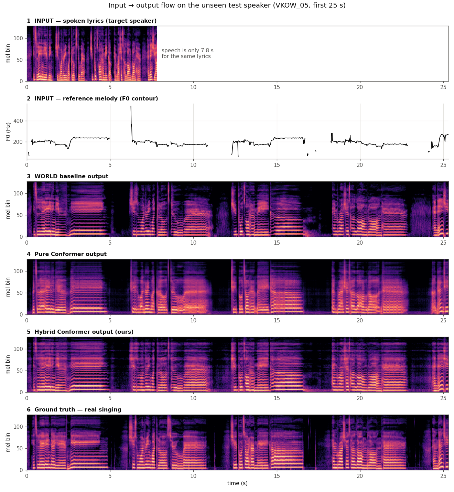

**Reading the flow figure (top to bottom):**

1. **Spoken input:** only 7.8 s of speech carries the lyrics that take 25 s to sing. Short, dense bursts.
2. **Reference melody:** the target pitch contour. Flat segments are held notes; gaps are unvoiced
   consonants and breaths.
3. **WORLD output:** already has the melody (the horizontal harmonic lines follow row 2) and the singing
   timing. But it shows WORLD's artefacts: sharp, buzzy harmonics up to the top bins and noisy
   texture in the gaps.
4. **Pure Conformer:** correct timing and harmonics, but blurred and smoothed — the "average voice"
   caused by L1 training and only 10 training speakers.
5. **Hybrid (ours):** keeps WORLD's structure and the speaker's timbre while the network reshapes the
   spectrum toward real singing. It still carries some of WORLD's high-frequency buzz.
6. **Real singing:** the target. Compare the darker, cleaner gaps and the softer upper harmonics.

---

## 4. Infrastructure

### 4.1 Machines

| Machine | Role |
|---|---|
| **Mac (Apple M4, 24 GB)** | Source of truth: code, git repo, Phase 1–2, WORLD baseline, results and demos |
| **GPU server** `172.17.16.11` (2× RTX 6000 Ada, 48 GB each; 64 cores; 724 GB RAM) | Phase 3 training, feature recomputation, evaluation. Reached over VPN. |

### 4.2 GPU server setup

- **Project directory:** `~/barani/speech-proc` (shared `nooglers` account).
- **Isolated environment:** `~/barani/speech-proc/.venv` (uv, Python 3.12, torch 2.11 + CUDA 12.8).
  The shared conda base and other users' environments were **not** modified; the base `torchaudio` is broken.
- **Jobs run in tmux** (`barani-s2s`), so training survives a dropped VPN/SSH connection.
- **GPU etiquette:** `nvidia-smi` is checked before every run. GPU 1 became busy with another user's job
  (32 GB, ~95% load), so training ran on **GPU 0 (user's choice)** alongside an idle Jupyter kernel.
  Training was capped at 50% of GPU memory and used ~4 GB.
- **Vocoder assets** (git-ignored, `vocoder/`): the DiffSinger repo (generator and STFT code) and the OpenVPI
  NSF-HiFiGAN 44.1 kHz checkpoint (CC BY-NC-SA 4.0, research use).

### 4.3 Data transfer

The Mac→server link is slow (~1 MB/s) and drops long transfers. The workaround:

- The corpus was converted to **lossless FLAC** (1,537 MB → 658 MB, bit-exact round trip).
- It was sent **one speaker at a time with retries** (PMAR needed 3 attempts) and verified with **MD5**
  (193/193 match).
- It was decoded back to bit-identical WAV on the server; features were recomputed there.
- Code syncs with `rsync --relative`; small files go via `ssh … 'cat >'` because scp/sftp is unavailable.

---

## 5. Repository layout

```
config/       data.yaml (paths, split), extract.yaml (model + feature parameters)
data/         annotations.py (phone parser), splits.py, nus_smc.py (index + manifest)
features/     audio.py (soundfile + resampling), hubert.py, ecapa.py, world_f0.py (Harvest),
              crepe_f0.py (reference only), mel.py, notes.py, vocoder.py (NSF-HiFiGAN), cache.py
baselines/    world_baseline.py (WORLD speech-to-singing + copy-synthesis)
scripts/      preprocess.py, verify_splits.py, sanity_check.py, data_study.py,
              train_duration.py, train_acoustic.py, evaluate.py
figures/      data study plots, F0 overlay, ECAPA heatmap, duration and mel comparison figures
docs          overview.md, approach.md, dataset.md, synthesis_archi.md, README.md, this report
```

Git-ignored (reproducible): the corpus, `features/cache/`, `outputs/`, `results/`, `checkpoints/`,
`vocoder/`, environments.

---

## 6. Phase 1 — Data preparation and feature extraction

| Feature | Source | Tool | Shape / rate |
|---|---|---|---|
| Content | spoken | HuBERT-base layer 9 | (T, 768) @ 50 Hz |
| Speaker | spoken | ECAPA-TDNN (SpeechBrain), 16 kHz input | (192,) |
| Melody F0 | sung | **WORLD Harvest** (60–1100 Hz) | (T,) @ 100 Hz, 0 = unvoiced |
| Notes | sung F0 | stable-pitch segmentation → MIDI | list of notes |
| Vocoder mel (target) | sung | NSF-HiFiGAN STFT, 128 bins | (T, 128) @ 86 Hz |
| WORLD-conversion mel | spoken → WORLD | same STFT | (T, 128) @ 86 Hz (hybrid input) |

### Bugs found and fixed in the original Phase 1

| Problem | Effect | Fix |
|---|---|---|
| ECAPA received 44.1 kHz audio (model expects 16 kHz) | weak speaker separation (cross-speaker similarity 0.68) | resample to 16 kHz → cross 0.14, same-speaker 0.93 |
| F0 plot time axis divided by 44,100 instead of 16,000 | F0 squeezed into 23 s of a 63 s song | correct frame period |
| torchcrepe never outputs 0 Hz | "f0 > 0 = voiced" was always true | mask by confidence |
| **CREPE-tiny fails on ~half the singers** (confidence ≈ 0, ~2-octave errors) | only 54% of sung vowels got a note | **switched melody F0 to WORLD Harvest** → 99.8% coverage |
| torchaudio ≥ 2.9 needs torchcodec/FFmpeg to load audio | loading fails on the server | load with soundfile (bit-identical) |
| Linux `fork` after CUDA init deadlocked the F0 workers | preprocessing hung | `spawn` process context |
| KENN's 48 kHz files | WORLD baseline assertion error | resample in the WORLD baseline |

---

## 7. Classical baseline — WORLD

`baselines/world_baseline.py`

1. WORLD-analyse the speech → spectral envelope (timbre), aperiodicity, F0.
2. Stretch each phone's frames to its sung duration (using the 1:1 phone map).
3. Replace F0 with the melody's F0.
4. Resynthesise.

Variants: **oracle** (annotated sung durations), **predicted** (Phase 2 durations, rescaled to the
melody's length), and **copy-synthesis** of the real singing (vocoder upper bound).

---

## 8. Phase 2 — Duration predictor

`scripts/train_duration.py`, 393k parameters.

**Per-phone inputs:** phone identity, log spoken duration, HuBERT averaged over the spoken phone, and
note features (MIDI pitch, log note length, has-note) of the overlapping note.
**Model:** 2-layer Transformer (d = 128, 4 heads) → log sung duration; MSE loss; early stopping on JLEE.

**Phone duration error (ms, non-silence phones):**

| Method | Val (JLEE) | Test (VKOW) |
|---|---|---|
| global ratio (×2.30) | 174.5 | 156.5 |
| per-phone median ratio | 156.1 | 137.0 |
| Transformer, no note input | 107.4 | 106.8 |
| **Transformer + notes** | **92.8** | **90.8** |

That is a 34% improvement over the best rule-based method; note conditioning adds a further 15%.
*Caveat:* phones are matched to notes using the sung timing — equivalent to a score with lyric→note
assignment. Arbitrary new melodies need an automatic lyric-to-note aligner.

---

## 9. Phase 3 — Acoustic model and vocoder

`scripts/train_acoustic.py`, `features/vocoder.py`

### 9.1 Conditioning (per mel frame, sung timeline, 86.1 Hz)

- **Content:** speech HuBERT time-warped phone by phone onto the singing timeline, by interpolating
  between phone boundaries (annotated durations in training, predicted at inference).
- **Speaker:** ECAPA embedding, broadcast over time.
- **Melody:** 256-bin mel-spaced pitch embedding of the gap-filled F0, plus a voicing flag.
- **Hybrid only:** mel of the WORLD conversion (carries the speaker's timbre).

### 9.2 Model and training

| | |
|---|---|
| Architecture | `torchaudio` Conformer, 6 layers, d = 256, 4 heads, FFN 1024, conv kernel 31 |
| Parameters | 9.48M (pure) / 9.52M (hybrid) |
| Hybrid output | `WORLD mel + correction`; correction layer zero-initialised, so training starts exactly at WORLD |
| Loss | L1 on 128-bin log-mel |
| Optimiser | AdamW, lr 5e-4, OneCycle, batch 32 × 512-frame crops, bf16, grad-clip 1.0 |
| Inference | whole songs in 512-frame chunks, cross-faded over 128 frames |
| Early stopping | patience 8 evaluations (8k steps) |
| Vocoder | pretrained NSF-HiFiGAN (44.1 kHz, 128 mels, hop 512), fed predicted mel + melody F0 |
| Vocoder check | copy-synthesis MCD 1.0 dB vs real singing |

### 9.3 Training runs (GPU 0)

| Run | Steps run | Best step | Best val L1 | Time | GPU memory |
|---|---|---|---|---|---|
| Pure Conformer | 40,000 | 9,000 | 1.053 | 23 min | 3.7 GB |
| Hybrid Conformer | 11,000 (early stop) | 3,000 | 1.114 (WORLD alone: 1.536) | 6 min | 4.0 GB |

Both runs overfit early. That's expected with 40 training songs; checkpoints are selected by validation L1.

**Ablation runs (GPU 1, same settings, one input removed; §10.5):**

| Run | Steps run (early stop) | Best step | Best val L1 |
|---|---|---|---|
| Pure, no melody input | 14,000 | 6,000 | 1.257 |
| Pure, no speaker input | 15,000 | 7,000 | 0.950 |
| Hybrid, no melody input | 21,000 | 13,000 | 1.151 |
| Hybrid, no speaker input | 15,000 | 7,000 | 1.016 |

**Regularisation runs (GPU 0, hybrid; §10.7):**

| Run | Steps run | Best step | Best val L1 |
|---|---|---|---|
| EMA of weights (decay 0.999) | 24,000 (early stop) | 16,000 | 1.111 |
| EMA + speaker-embedding noise 0.5σ | 40,000 (limit) | 40,000 | 1.040 |
| EMA + speaker-embedding noise 1.0σ | 40,000 (limit) | 40,000 | 1.040 |
| Learning rate 1e-4 (eval every 500, patience 12) | 7,000 (early stop) | 1,000 | 1.105 |

---

## 10. Results

`scripts/evaluate.py`

**Metrics:**
- **MCD:** mel-cepstral distortion, c1–c24, frame-aligned, non-silent frames. MFCC-style, so not
  directly comparable to SPTK MCD in papers.
- **F0 RMSE and correlation:** WORLD Harvest on frames voiced in both signals.
- **Speaker similarity:** ECAPA cosine between the output and the speaker's *spoken* recording.

### 10.1 Test speaker VKOW (unseen)

| System | MCD ↓ | F0 RMSE (Hz) ↓ | F0 CORR ↑ | Speaker sim ↑ |
|---|---|---|---|---|
| **Real durations** | | | | |
| WORLD | 4.32 | 17.6 | 0.891 | 0.657 |
| Pure Conformer | **3.73** | 29.2 | 0.739 | 0.000 |
| **Hybrid Conformer** | 4.12 | **13.3** | **0.931** | 0.354 |
| **Predicted durations (fully automatic)** | | | | |
| WORLD | 6.28 | 22.1 | 0.849 | 0.645 |
| Pure Conformer | **5.04** | 32.1 | 0.697 | 0.007 |
| **Hybrid Conformer** | 5.48 | **17.7** | **0.891** | 0.341 |
| **References** | | | | |
| NSF-HiFiGAN copy-synthesis | 1.01 | 11.6 | 0.948 | 0.450 |
| WORLD copy-synthesis | 0.71 | 14.6 | 0.920 | 0.394 |
| Real singing | 0 | 0 | 1.000 | 0.436 |

### 10.2 Validation speaker JLEE (unseen)

| System | MCD | F0 RMSE | F0 CORR | Speaker sim |
|---|---|---|---|---|
| WORLD (real durations) | 4.01 | 17.8 | 0.916 | 0.599 |
| Pure Conformer (real durations) | 3.49 | 26.9 | 0.756 | 0.069 |
| Hybrid (real durations) | 3.64 | 16.7 | 0.919 | 0.401 |
| Hybrid (predicted durations) | 5.08 | 21.8 | 0.883 | 0.432 |
| Real singing | 0 | 0 | 1.000 | 0.616 |

### 10.3 Interpretation

- **Pure Conformer:** best spectral match (MCD), but it **loses the speaker** (similarity ≈ 0) and pitch.
  With only 10 training speakers, an ECAPA embedding cannot teach it new voices, so it collapses to an
  average voice.
- **Hybrid Conformer:** refining WORLD **recovers speaker identity** (0.35 vs 0.44 for real singing), gives
  the **best pitch accuracy of all systems**, and **still beats WORLD on MCD**, in both the oracle and the
  fully automatic setting.
- **WORLD's 0.66 speaker score is inflated:** its output keeps the *speech* timbre, which is exactly what
  the metric compares against. Real singing scores only 0.44 because singing shifts the embedding.

### 10.4 Research questions — answers

| RQ | Answer |
|---|---|
| RQ1 Content | ✅ Time-warped HuBERT carries the lyrics; phone timing lines up in the output |
| RQ2 Speaker | ⚠️→✅ Fails in the pure model; recovered by the hybrid (0.35 vs 0.44 for real singing) |
| RQ3 Melody | ✅ Hybrid pitch error 13.3 Hz, correlation 0.93 (best of all systems); it also follows another singer's melody or a transposed one (0.90–0.92 correlation, Exp 2, §10.8) without taking on that singer's voice |
| RQ4 Alignment | ✅ 90.8 ms phone duration error, 34% better than rule-based |

### 10.5 Ablations — what each input contributes (Exp 4 and Exp 5)

Each model was retrained with one input removed: the **melody** (pitch embedding and voicing flag;
`--no-pitch`) or the **speaker** embedding (ECAPA; `--no-speaker`). Real durations throughout.

| System | Test MCD ↓ | Test F0 RMSE (Hz) ↓ | Test F0 CORR ↑ | Test speaker ↑ | Val MCD | Val F0 RMSE | Val speaker |
|---|---|---|---|---|---|---|---|
| Pure Conformer (full) | 3.73 | 29.2 | 0.739 | 0.000 | 3.49 | 26.9 | 0.069 |
| Pure, no melody | 4.03 | 43.4 | 0.409 | 0.008 | 3.71 | 76.2 | 0.117 |
| Pure, no speaker | 3.73 | 12.9 | 0.936 | 0.110 | 3.37 | 12.2 | 0.186 |
| Hybrid (full) | 4.12 | 13.3 | 0.931 | **0.354** | 3.64 | 16.7 | **0.401** |
| Hybrid, no melody | 4.19 | 14.4 | 0.919 | 0.327 | 3.68 | 16.4 | 0.353 |
| Hybrid, no speaker | **3.68** | **11.3** | **0.952** | 0.153 | **3.33** | **11.7** | 0.206 |

**What this shows:**
- **Melody input:**
  - In the pure model, it is the only source of pitch. Without it, pitch tracking collapses (test correlation
    0.74 → 0.41) and the harmonics blur into a flat average pitch (§15.12).
  - The hybrid barely needs it (0.93 → 0.92). The WORLD mel already contains the melody's harmonics, so
    the hybrid's pitch comes mostly from its WORLD input.
- **Speaker input (ECAPA):**
  - *Pure model:* removing ECAPA **improves** pitch a lot (29.2 → 12.9 Hz on test, 26.9 → 12.2 on val)
    and even the speaker score (0.00 → 0.11). With only 10 training speakers, the embedding of an
    unseen speaker is an input the model never saw, and it disturbs the output. This is the overfitting
    behind the pure model's speaker collapse (§10.3).
  - *Hybrid:* ECAPA is what keeps the voice. Without it, the speaker score halves (0.35 → 0.15), while MCD
    and pitch improve. The model drifts towards an average singing voice, which is closer on average
    spectra but less like the speaker.
- **Takeaway:** the hybrid's design is confirmed. WORLD supplies melody and timbre; ECAPA anchors
  identity. Trading identity for MCD (the no-speaker hybrid) defeats the project's goal, so the full hybrid
  stays the main system.
- **Caveats:**
  - Single seed per run.
  - Early stopping picked different points: the full hybrid at step 3,000 (still close to its WORLD
    starting point, which has a high speaker score), the no-speaker hybrid at step 7,000. Part of the
    hybrid's trade-off is "how far training moved away from WORLD", not the speaker input alone.

### 10.6 Adversarial (GAN) fine-tuning — negative result

`scripts/finetune_gan.py` (background: B14). This targets the over-smoothing / buzz noted in §15.10.

**Setup:**
- **Discriminator:** a 2-D patch discriminator on mel crops (0.43M parameters; LSGAN + feature matching).
- **Generator loss:** `L1 + λ_adv · adversarial + 0.1 · feature-matching`.
- **Runs:** the trained hybrid fine-tuned for 6,000 steps with λ_adv = 0.1 and 0.5. Snapshots at 2k, 4k and
  6k steps.
- **Gate (validation speaker JLEE only; the test speaker was never used):** a snapshot would replace the
  hybrid only if MCD improves, F0 RMSE rises by ≤ 0.5 Hz and speaker similarity drops by ≤ 0.01.

| Candidate (JLEE) | MCD ↓ | F0 RMSE (Hz) ↓ | F0 CORR ↑ | Speaker ↑ | Mel L1 ↓ |
|---|---|---|---|---|---|
| Hybrid (no GAN) | **3.64** | **17.0** | **0.917** | 0.401 | **1.114** |
| λ 0.1, 2k steps | 4.07 | 17.1 | 0.917 | 0.431 | 1.220 |
| λ 0.1, 4k steps | 4.40 | 18.0 | 0.908 | 0.428 | 1.298 |
| λ 0.1, 6k steps | 4.46 | 20.2 | 0.892 | 0.445 | 1.304 |
| λ 0.5, 2k steps | 4.11 | 18.3 | 0.907 | 0.419 | 1.230 |
| λ 0.5, 4k steps | 4.45 | 20.3 | 0.889 | 0.416 | 1.293 |
| λ 0.5, 6k steps | 4.55 | 18.0 | 0.907 | **0.452** | 1.324 |

(The hybrid row matches §10.2 on MCD and speaker similarity to three decimals. Its F0 RMSE is 17.0 here vs
16.7 there because the gate re-renders the audio, and tiny waveform differences shift a few Harvest
pitch frames.)

**Outcome:**
- **No snapshot passed**, so no GAN checkpoint was saved and the hybrid remains the final model.
- Every snapshot got worse on MCD and mel L1, increasingly with more steps. Pitch was the same or worse.
- Only speaker similarity rose slightly (up to +0.05).
- The training log was healthy (discriminator loss stayed around 0.35–0.49; it never "won"). The
  problem is not unstable training.

**Why:** the discriminator pushes towards sharper, more detailed spectra, but those details cannot be
predicted exactly frame by frame. Frame-aligned MCD and L1 penalise every deviation, so they get worse
even when the output is less smooth. Whether the GAN versions *sound* better can only be decided by a
listening test. The rendered candidates are kept on the server in `outputs/gan_val/` for that purpose.

### 10.7 Regularisation — no variant passes; a speaker-vs-MCD trade-off

`scripts/train_acoustic.py --ema / --spk-noise / --lr`. The hybrid overfits after 3,000 steps (§9.3). Three
standard fixes were tried, under the same validation gate as §10.6:
- **EMA:** the saved model is an exponential moving average of the weights (decay 0.999).
- **Speaker-embedding noise:** Gaussian noise on the ECAPA input during training, scaled by the per-dimension
  standard deviation over the training songs, so the model cannot memorise the 10 training speakers.
- **Lower learning rate:** 1e-4 instead of 5e-4, evaluated every 500 steps.

| Hybrid variant | Val MCD ↓ | Val F0 RMSE (Hz) ↓ | Val speaker ↑ | Test MCD | Test F0 RMSE | Test speaker | Gate |
|---|---|---|---|---|---|---|---|
| **Hybrid (final)** | **3.64** | 16.7 | 0.401 | **4.12** | 13.3 | 0.354 | — |
| EMA | 3.66 | 16.1 | 0.270 | 4.43 | 13.0 | 0.296 | ✗ MCD, speaker |
| EMA + noise 0.5σ | 3.28 | **11.8** | 0.207 | 3.68 | **12.1** | 0.153 | ✗ speaker |
| EMA + noise 1.0σ | 3.30 | 13.3 | 0.204 | 3.70 | 12.9 | 0.150 | ✗ speaker |
| Learning rate 1e-4 | 3.81 | 17.2 | **0.564** | 4.21 | 16.9 | **0.615** | ✗ MCD |

**What this shows (figure: `figures/tradeoff_mcd_speaker.png`, §15.13):**
- **Speaker noise = no speaker input.** Both noise levels land on the no-speaker ablation of §10.5 (val MCD 3.33,
  speaker 0.206): the model learns to ignore a noisy embedding. MCD and pitch improve, the voice is lost.
- **The lower learning rate stays near WORLD.** Its best checkpoint (step 1,000) has moved little from the WORLD
  input, so it keeps the speech timbre (speaker 0.56–0.62) and WORLD's weaker pitch and MCD.
- **EMA** only delays overfitting: the averaged model peaks later (16,000 steps) at the same val L1 and is worse
  on every metric.
- **Every variant moves along one curve:** lower MCD comes with lower speaker similarity. None is better on
  both, so the final hybrid stays. It sits in the middle of the curve, close to real singing's similarity on
  test (0.35 vs 0.44).
- **Speaker scores above real singing are not a win.** The metric compares with the *spoken* voice, so a
  speech-like output (WORLD 0.66, lr 1e-4 0.62) scores above real singing (0.44) (§10.3).
- **Since nothing passed,** `--ema` and `--spk-noise` were not committed (they exist only in the working copy);
  the runs are documented here.

### 10.8 Exp 2 — a different melody

`scripts/exp2_melody.py`. Exp 1 always used the speaker's *own* melody. Exp 2 tests the actual objective (§1):
the melody is controlled independently of the speaker.

**Conditions (all 8 val/test songs, JLEE and VKOW):**
- **Cross-singer, 20 pairs:** the speaker's spoken lyrics sung to *another singer's* rendition of the same song
  (every other singer in the corpus who sang it).
  - The melody is moved by whole octaves towards the speaker: 12 × round(log2 of the ratio of the two speaking
    voices' median F0). That is −12 semitones for 14 pairs (a higher-voiced singer's melody for a lower-voiced
    speaker) and 0 for 6.
- **Transposed own melody, 3 per song:** −3, 0 and +3 semitones. The 0 case is the control and must reproduce Exp 1.
- **Every condition** is rendered by WORLD, the pure and the hybrid model, each with three timings
  (`infer.py --durations`):
  - `reference`: the melody singer's phone timing;
  - `phrase`: predicted with the melody's rests kept in place (described below);
  - `predicted`: predicted and stretched to the melody's length.
- 44 conditions × 9 renderings = 396 outputs, about 2.5 min each.

**Finding: renditions of the same song differ in their lyrics.**
- Two singers' annotations of the same song never have identical phone sequences. Only 77–89% of the phones
  match: singers repeat or skip chorus lines, and the phone transcriptions differ in places.
- `infer.py` now aligns the two annotations phone by phone, by minimum edit distance (Levenshtein).
  - Python's `difflib` was tried first and failed. Its greedy matching paired a repeated chorus with the wrong
    repeat (14% matched on one pair).
  - Matched phones copy the melody singer's timing exactly. A mismatched stretch shares its sung time among its
    spoken phones in proportion to their spoken durations.
- **Safety check:** inference refuses pairs with under 70% matched phones. Different songs in the corpus
  match ≤ 56%.
- **Clean region:** each cross pair is cut to the longest stretch whose differences are at most 5 phones each,
  starting and ending at a pause both annotations share. On average this keeps 166 s (113–190 s) of the song.

**Metrics.** There is no real singing to compare with, except in the 0-shift control:
- **Melody adherence:** F0 RMSE in cents and F0 correlation of the output against the (shifted) melody F0.
- **Speaker similarity:** ECAPA cosine to the speaker's own speech.
- **Leakage:** ECAPA cosine to the *melody singer's* speech. This checks whether the output takes on the melody
  singer's voice. For comparison, the two speakers' own voices have a cosine of 0.166 on average.

**Results (reference timing, mean over songs):**

| Condition | System | F0 RMSE (cents) ↓ | F0 CORR ↑ | Speaker ↑ | Leakage (vs 0.166) ↓ |
|---|---|---|---|---|---|
| Own melody (Exp 1 control) | WORLD | 167 | 0.903 | 0.628 | — |
| | Pure | 272 | 0.746 | 0.035 | — |
| | **Hybrid** | **141** | **0.922** | 0.377 | — |
| Own melody −3 semitones | WORLD | 153 | 0.903 | 0.681 | — |
| | **Hybrid** | **144** | **0.909** | 0.393 | — |
| Own melody +3 semitones | WORLD | 181 | 0.896 | 0.547 | — |
| | **Hybrid** | **145** | **0.916** | 0.342 | — |
| **Another singer's melody (20 pairs)** | WORLD | 176 | 0.896 | 0.679 | 0.126 |
| | Pure | 329 | 0.649 | 0.026 | 0.094 |
| | **Hybrid** | **166** | **0.899** | 0.408 | **0.086** |

**What this shows:**
- **The control reproduces Exp 1 exactly:** hybrid MCD 3.64 (JLEE) and 4.12 (VKOW), the same as §10.1–10.2.
- **The hybrid follows a new melody:**
  - Pitch accuracy stays within 4 cents of the own melody when transposed by ±3 semitones.
  - With another singer's melody it stays within 25 cents. That melody is a different performance, with its own
    timing, vibrato and octave move.
  - The hybrid tracks the melody best of all three systems in every condition. WORLD gets worse at +3 semitones
    (167 → 181 cents), while the hybrid barely changes (141 → 145).
- **The voice stays the speaker's, not the melody singer's:**
  - Hybrid speaker similarity is the same with another singer's melody (0.41) as with the own melody (0.38).
  - Leakage to the melody singer is 0.086, *below* the 0.166 similarity of the two singers' own voices. The output
    is less like the melody singer than the speaker's own speech is. This holds in 18 of 20 pairs (phrase timing).
  - The melody carries only pitch and timing, no timbre. That is by design: F0 is the only input taken from the
    melody audio.
- **Pitching up costs some speaker similarity** (hybrid 0.38 → 0.34 at +3, WORLD 0.63 → 0.55). Pitching down
  costs none. Higher pitch moves the harmonics further from the speaker's spoken formant pattern, which ECAPA
  picks up.
- **The pure model stays unusable** (F0 correlation 0.65, speaker 0.03), as in Exp 1.

**System improvement: phrase timing (`--durations phrase`).**
- **The problem:** with fully predicted timing (`predicted`), small duration errors add up over a song. The
  median phrase started 2.8 s away from the melody's phrase, so lyrics drifted across the melody's rests.
- **The fix:** `phrase` keeps every melody rest (a pause ≥ 0.5 s) at its reference position and length. Each
  phrase between rests gets the predicted durations, rescaled to the phrase's span in the melody. This is how a
  singer reads a score: rests are fixed, and timing inside a phrase is free.
- **Result:** the phrase-boundary error drops from 2.8 s to about 0.33 s (median per song 0.13–0.89 s).

| Own melody, vs real singing (8 songs) | Timing | MCD ↓ | F0 RMSE (cents) ↓ |
|---|---|---|---|
| WORLD | predicted → **phrase** | 6.05 → **5.35** | 223 → **196** |
| Pure | predicted → **phrase** | 4.88 → **4.46** | 282 → 288 |
| Hybrid | predicted → **phrase** | 5.28 → **4.76** | 185 → **165** |
| Hybrid | reference (oracle, upper bound) | 3.88 | 141 |

- Phrase timing improves the fully automatic MCD of all three systems by 0.4–0.7 dB. It closes about a third of
  the gap to reference timing.
- It also improves pitch adherence with another singer's melody (hybrid 203 → 175 cents).
- It needs nothing beyond what `predicted` already uses: the rests come from the melody's annotation, which
  `predicted` needs anyway to match notes to phones.

**Caveats:**
- The melody still comes from an annotated rendition of the *same* song. A truly new song needs automatic
  lyric-to-note alignment (§14).
- Exp 2 has no listening test. Leakage and speaker similarity are ECAPA scores, which §10.3 shows are inflated
  for speech-like outputs.

---

## 11. Deliverables

| Item | Location |
|---|---|
| Demo clips: all 8 val/test songs × 10 versions, same 25 s lyric window (spoken input → WORLD → pure → hybrid → real singing) | `outputs/demo/` (Mac), `scripts/make_demos.py` |
| Inference CLI: spoken lyrics + reference singing (any singer, transposable) → the speaker singing, from raw audio | `infer.py` |
| Exp 2: 44 different-melody conditions × 3 systems × 3 timings | `outputs/exp2/` (server), `results/exp2{,_summary}.csv` |
| Exp 2 listening excerpts (25 s): cross-singer and ±3 semitone examples | `outputs/exp2_demo/` (Mac) |
| Full generated songs | `outputs/{world,world_pred,acoustic_*,hybrid_*,nsf_copysyn}/` |
| Metrics | `results/eval*.csv` (incl. `eval_ablation*.csv`, `eval_hybrid_{ema,ema_spk05,ema_spk10,lr1}*.csv`), `results/duration*.csv`, `results/gan_gate.csv` |
| Training curves | `results/{acoustic,hybrid}{,_nopitch,_nospk}_train.csv` |
| Figures | `figures/duration_pred_VKOW_05.png`, `figures/{acoustic,hybrid}{,_nopitch,_nospk}_mel_VKOW_05.png`, `figures/tradeoff_mcd_speaker.png`, data study plots |
| Checkpoints | `checkpoints/duration.pt` (Mac), `checkpoints/{acoustic,hybrid}.pt` (server) |

---

## 12. How to reproduce

```bash
pip install -r requirements.txt

# Phase 1 — features (Mac or server)
python scripts/preprocess.py                  # hubert ecapa crepe f0 mel notes
python scripts/verify_splits.py
python scripts/sanity_check.py
python scripts/data_study.py

# Baseline + Phase 2
python baselines/world_baseline.py
python scripts/train_duration.py
python baselines/world_baseline.py --durations predicted

# Phase 3 (CUDA GPU; vocoder assets in vocoder/, see README step 10)
python scripts/preprocess.py --components vmel wmel
CUDA_VISIBLE_DEVICES=0 python scripts/train_acoustic.py                  # pure
CUDA_VISIBLE_DEVICES=0 python scripts/train_acoustic.py --world-input    # hybrid

# Evaluation
python scripts/evaluate.py --systems acoustic_oracle acoustic_pred nsf_copysyn world world_pred world_copysyn gt
python scripts/evaluate.py --systems hybrid_oracle hybrid_pred --csv results/eval_hybrid.csv

# Ablations (§10.5): --no-pitch / --no-speaker, with and without --world-input
CUDA_VISIBLE_DEVICES=1 python scripts/train_acoustic.py --no-pitch
CUDA_VISIBLE_DEVICES=1 python scripts/train_acoustic.py --world-input --no-speaker
python scripts/evaluate.py --systems acoustic_nopitch_oracle acoustic_nospk_oracle \
    hybrid_nopitch_oracle hybrid_nospk_oracle --csv results/eval_ablation.csv

# GAN fine-tuning + validation gate (§10.6) -> results/gan_gate.csv
CUDA_VISIBLE_DEVICES=1 python scripts/finetune_gan.py

# Exp 2 (§10.8) -> outputs/exp2/, results/exp2{,_summary}.csv
CUDA_VISIBLE_DEVICES=0 python scripts/exp2_melody.py

# Demo excerpts and inference on new audio
python scripts/make_demos.py
python infer.py --speech read/05.wav --speech-phones read/05.txt \
                --melody sing/05.wav --melody-phones sing/05.txt --out out.wav \
                [--model hybrid|acoustic|world] [--durations reference|phrase|predicted] [--transpose -12]
```

---

## 13. Commit history

```
feat(exp2): added the different-melody experiment on 20 cross-singer pairs and ±3 semitone shifts, where the hybrid follows the new melody (0.90 F0 correlation) without taking on the melody singer's voice (0.09 vs 0.17 speaker similarity).
feat(infer): aligned another singer's annotation by minimum edit distance and added melody transposition, the WORLD system and rest-anchored phrase timing (own-melody MCD 5.28 to 4.76 dB vs predicted durations).
chore(figures): added the test-song mel-spectrogram figures of the four melody and speaker ablation models.
feat(gan): added validation-gated adversarial fine-tuning of the hybrid with a mel patch discriminator, which no snapshot passed (val MCD 3.64 dB rose to 4.07-4.55 dB).
feat(infer): added an end-to-end inference CLI that turns spoken lyrics plus a reference singing into the speaker's singing from raw audio.
refactor(acoustic): shared the conditioning, data loading and generation code so inference reuses the training path (outputs reproduce at 0.9999 correlation).
feat(acoustic): added melody and speaker ablations, finding that ECAPA conditioning hurts unseen-speaker pitch (test F0 RMSE 29.2 to 12.9 Hz without it).
feat(demo): added a script that cuts aligned listening excerpts of every validation and test song for all systems.
docs(report): added the project report with domain background, an input-to-output walkthrough, explained figures and results.
fix(analysis): replaced the empty CREPE F0 range plot with a per-speaker Harvest speech-vs-singing comparison and trimmed the duration histogram to phones under 1 s.
feat(hybrid): trained a 9.52M parameter Conformer that refines the WORLD conversion, raising test speaker similarity from 0.00 to 0.35 and F0 correlation to 0.93.
feat(acoustic): added early stopping on validation L1 with a patience of 8 evaluations.
fix(baseline): resampled the 48 kHz KENN recordings in the WORLD baseline instead of asserting 44.1 kHz input.
feat(acoustic): trained a 9.48M parameter Conformer acoustic model with NSF-HiFiGAN vocoding, reaching 3.73 dB test MCD vs 4.32 dB for WORLD.
fix(preprocess): started Harvest F0 workers with spawn to avoid a fork deadlock after CUDA initialisation on Linux.
feat(vocoder): integrated the pretrained 44.1 kHz NSF-HiFiGAN vocoder and cached its 128-bin mels as acoustic targets (1.11 dB copy-synthesis MCD).
fix(audio): loaded wav files with soundfile so torchaudio no longer needs torchcodec and FFmpeg.
docs(readme): documented setup, pipeline steps, feature cache layout and module map.
feat(eval): added MCD, F0 RMSE/correlation and ECAPA speaker similarity evaluation of generated singing.
feat(baseline): added the WORLD speech-to-singing baseline with oracle or predicted phone durations.
feat(duration): trained a 393k parameter note-conditioned Transformer duration predictor reaching 90.8 ms phone MAE on the test speaker.
feat(analysis): added feature sanity checks and a speech-vs-singing data study with figures.
feat(features): extracted and cached HuBERT, 16 kHz ECAPA, CREPE, Harvest melody F0, log-mel and note features for all 48 pairs.
feat(data): added the NUS-48E phone annotation parser, speaker-disjoint 10/1/1 split and split manifest.
docs(design): added the project overview, technical approach, dataset and synthesis architecture documents.
chore(git): ignored the dataset, feature cache, environments and generated artifacts.
```

---

## 14. Limitations and next steps

| Limitation | Next step |
|---|---|
| Output is somewhat over-smoothed / muffled (an L1-loss artefact) | A mel GAN fine-tune was tried (§10.6) and made every objective metric except speaker similarity worse. Next: judge the GAN versions by listening, or try a GAN-trained / diffusion decoder instead of fine-tuning |
| ECAPA conditioning fails for unseen speakers in the pure model (§10.5) | more training speakers; speaker augmentation; or rely on the hybrid's WORLD input for timbre |
| The melody must be an annotated rendition of the same song (Exp 2 used other singers' renditions, §10.8) | automatic lyric-to-note alignment, so any melody with the right syllable count can be used |
| Fully automatic timing still costs 0.9 dB MCD vs reference timing, even with phrase timing (§10.8) | condition the duration model on the melody's note onsets inside each phrase |
| Speaker similarity below real singing (0.35 vs 0.44) | a reference encoder over the speaker's spoken mel; more speakers (e.g. NHSS) |
| Small data (40 training songs) → early overfitting | EMA, speaker-embedding noise and a lower learning rate were tried (§10.7); each only moved along the MCD–speaker trade-off. Next: pitch-shift / tempo augmentation, more singers |
| Objective metrics only | MUSHRA-style listening test (≥ 10 listeners), per `approach.md` §7; the demo clips are ready for it |
| Ablations and GAN runs are single-seed | repeat with 3 seeds; fix the training length to separate the input effect from early stopping |
| MCD is MFCC-style, frame-aligned | DTW-aligned SPTK MCD for comparison with published work |


---

## 15. Figures explained

All figures are in `figures/` (generated by the project scripts) or `figures/report/` (generated for this
report by `figures/report/make_report_figures.py`).

### 15.1 Phone durations: speech vs singing

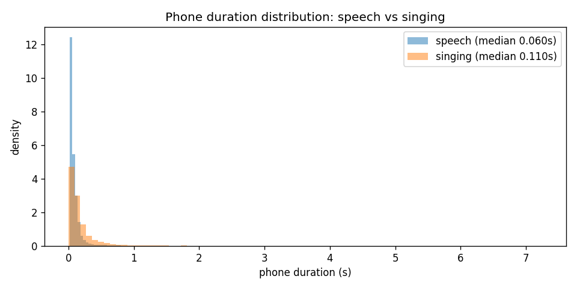

- **What it shows:** how long phones last, over all ~34,000 phone instances in each mode (phones under 1 s).
- **How to read it:** blue = speech, orange = singing, as density histograms.
- **Takeaway:** the median phone lasts **60 ms in speech vs 110 ms in singing**, and singing has a long
  tail of held notes (up to several seconds). This shift is what the duration model must learn (Phase 2).

### 15.2 Which phones stretch the most

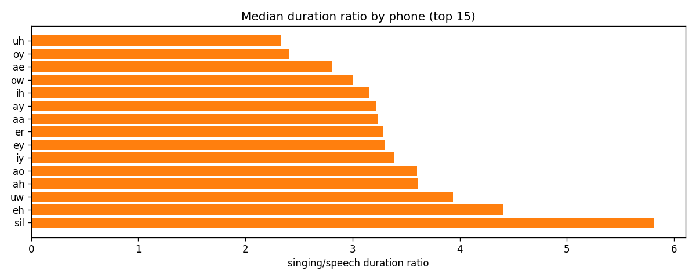

- **What it shows:** for each phone type, the median ratio *sung duration ÷ spoken duration*.
- **Takeaway:** the top of the list is all **vowels** (`eh` 4.4×, `uw` 3.9×, `ah`/`ao` 3.6×, …), because
  singers hold vowels on notes while consonants stay short. `sil` tops the chart because sung pauses are
  much longer than spoken ones. This is why a single global stretch factor is a poor model and the duration
  model needs phone identity.

### 15.3 Phone inventory

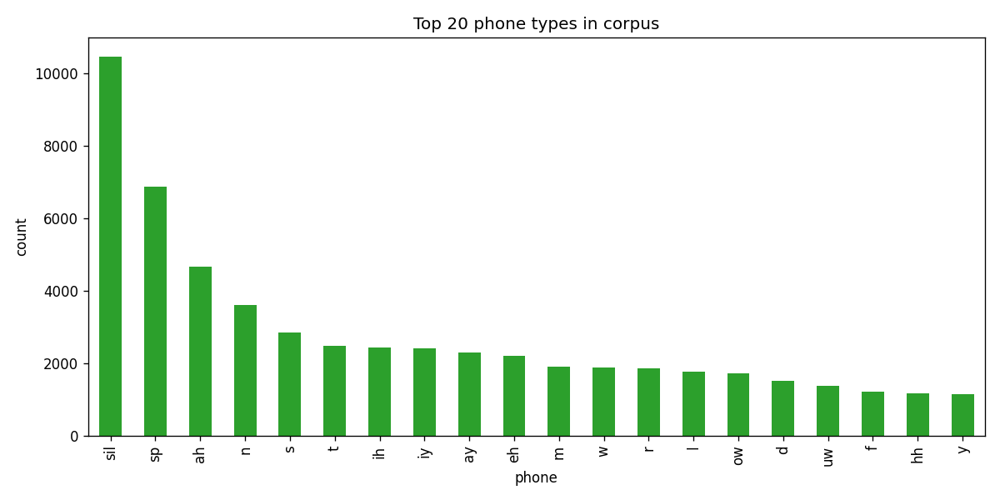

- **What it shows:** the 20 most frequent phone types (both modes).
- **Takeaway:** silences dominate (`sil` ~10,400, `sp` ~6,900 — mostly the zero-length sung pauses);
  then common English sounds such as `ah`, `n`, `s`, `t`. With 41 phone types in total, a phone embedding
  is small and easy to learn.

### 15.4 Pitch: speech vs singing per speaker

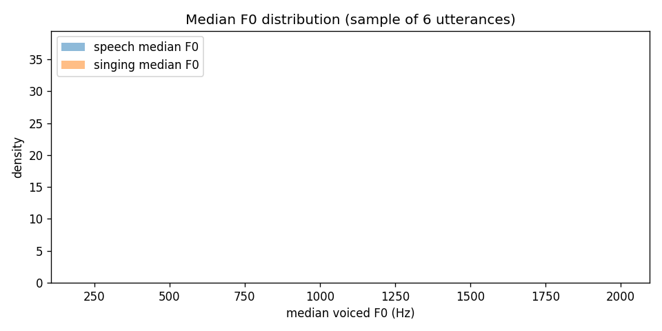

- **What it shows:** for each speaker (one song each), the median F0 (dot) and the 5–95% pitch range
  (bar), speaking (blue) vs singing (orange), on a log-frequency axis where equal distances are equal
  musical intervals.
- **How to read it:** speakers are sorted by speaking pitch; the bottom half (~110–150 Hz) are the lower,
  mostly male voices.
- **Takeaway:** **everyone sings higher than they speak — on average 1.42× (+5.8 semitones)**, from
  +0.3 st (NJAT) to +10.7 st (JLEE). The singing range is also wider (12.7 vs 9.1 semitones on average).
  The system must therefore move pitch a long way from the speech, which is why melody F0 is given
  explicitly to both the model and the vocoder.

### 15.5 Speaker embeddings separate speakers

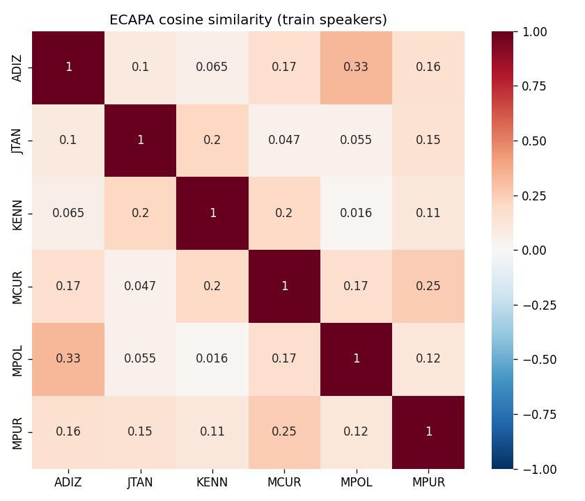

- **What it shows:** cosine similarity between ECAPA embeddings of six training speakers' spoken
  recordings (one each).
- **How to read it:** dark red diagonal = a speaker vs themselves (1.0); pale cells = different speakers.
- **Takeaway:** cross-speaker similarity is low (0.02–0.33; mean 0.14 over all pairs), and same-speaker
  pairs across *different* songs average 0.93. The embeddings reliably identify speakers, which makes ECAPA
  a valid conditioning signal and speaker-similarity metric. This figure only looked like this after the
  16 kHz fix; before it, cross-speaker similarity was 0.68.

### 15.6 Melody F0 aligned with the spectrogram

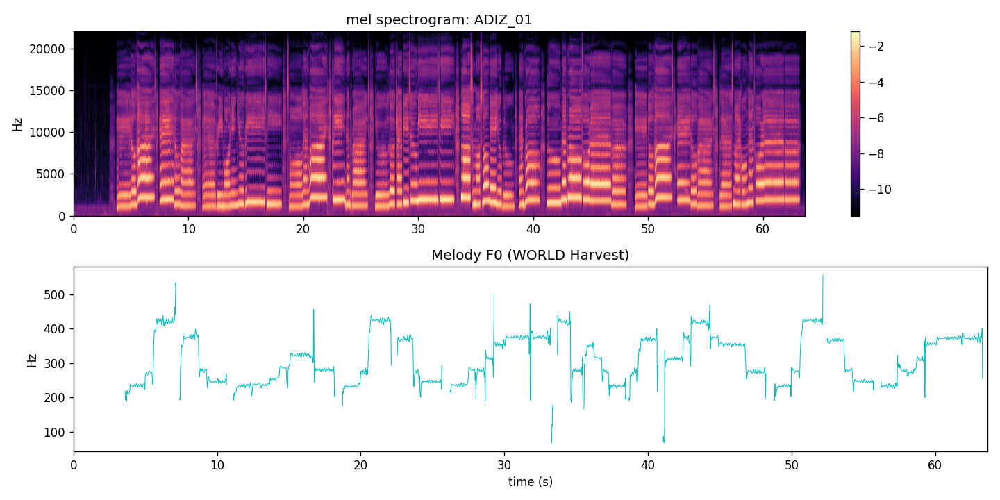

- **What it shows:** top, the mel spectrogram of a sung song (ADIZ_01); bottom, its Harvest F0 on the same
  time axis.
- **Takeaway:** each pitch step in the bottom panel lines up with the harmonic lines moving in the top panel,
  which confirms that the F0 cache and timing are correct. The earlier version of this plot was squeezed into
  23 s because of a wrong time axis, and showed ~2000 Hz in silences (unmasked CREPE output).

### 15.7 Phone-by-phone time warping

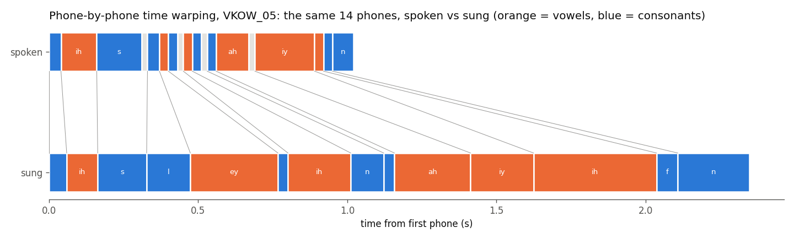

- **What it shows:** the first 14 phones of VKOW_05, spoken (top) vs sung (bottom), on a common time axis
  (orange = vowels, blue = consonants, grey = pauses). Grey lines connect each phone's start in the two versions.
- **Takeaway:** the same phones take ~1 s spoken and ~2.3 s sung. The stretch goes almost entirely into
  vowels (`ey`, `ih`, `ah`, `iy` become several times longer), and short spoken pauses vanish. The
  acoustic model's content input is warped exactly like this, mapping each singing frame back to its
  moment in the speech.

### 15.8 Duration predictions on the test speaker

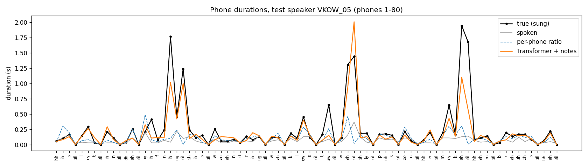

- **What it shows:** phone durations for the first 80 phones of VKOW_05: true sung (black), spoken (grey),
  the per-phone-ratio baseline (dashed blue), and the Transformer duration model with note input (orange).
- **Takeaway:** the ratio baseline only scales the speech and misses held notes. The Transformer follows the
  big sung peaks (1–2 s held vowels) because it knows where the notes are. It tends to *under*-predict the very
  longest notes (a typical effect of a log-domain MSE loss), which is why predicted durations are rescaled
  to the melody's length before synthesis.

### 15.9 Training curves

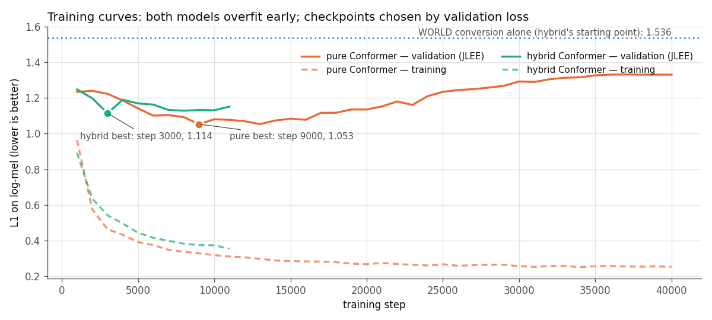

- **What it shows:** L1 loss per 1,000 steps for both acoustic models; solid = validation speaker (JLEE),
  dashed = training data.
- **How to read it:** a widening gap between dashed (falling) and solid (rising) lines = overfitting.
- **Takeaway:**
  - **Pure model:** training loss keeps falling to ~0.25, but validation bottoms out at step 9,000 (1.053)
    and then rises — classic overfitting with 40 songs.
  - **Hybrid:** starts from WORLD's level (dotted line, 1.536) and improves quickly to 1.114 at step 3,000.
    Early stopping ended it at 11,000 steps instead of 40,000.
  - Its validation L1 is slightly higher than the pure model's, yet it scores much better on pitch and
    speaker identity. L1 on the mel does not capture everything listeners care about.

### 15.10 Real vs generated spectrograms

| Pure Conformer | Hybrid Conformer |
|---|---|
| 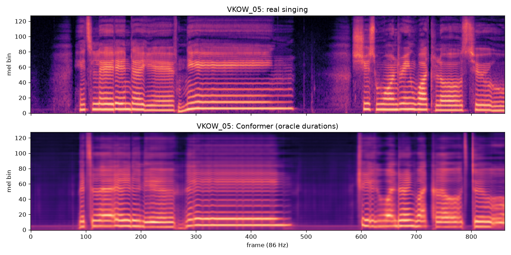 | 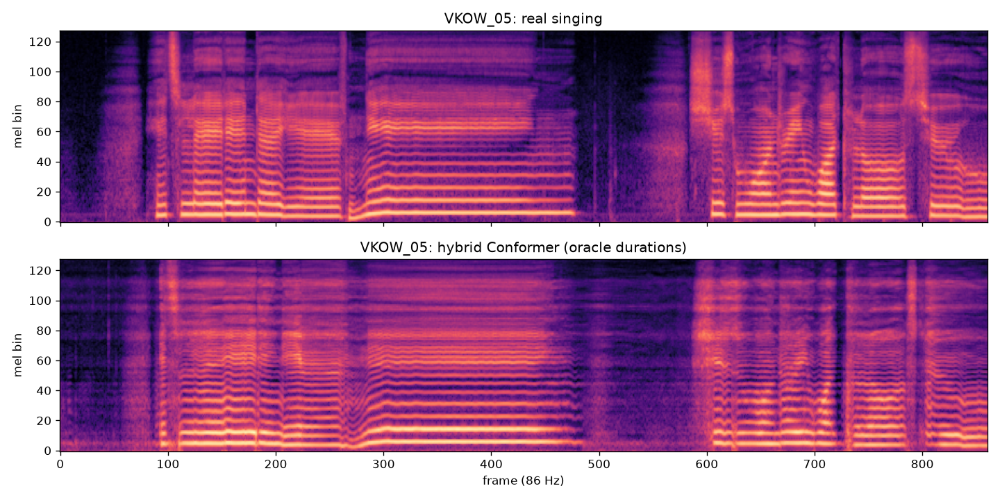 |

- **What it shows:** 10 s of the test song VKOW_05: top, real singing; bottom, model output with annotated
  durations (128 mel bins, 86 frames/s).
- **Pure model:** harmonic lines follow the melody and the timing matches, but the upper half is smeared,
  the harmonics are fuzzy, and the pauses have a slightly raised noise floor (~1 log-unit louder than real,
  evenly across frequencies — not a tonal hum).
- **Hybrid:** much crisper, more defined harmonics (inherited from WORLD), so pitch accuracy and speaker
  identity improve. But it also inherits WORLD's buzz: harmonic stripes reaching the top bins and faint
  stripes in the pauses, where real singing is breathier and softer. This is the main quality issue to
  address next (adversarial loss, B14).

### 15.11 Results comparison

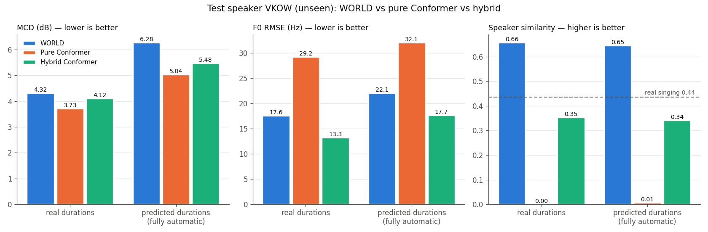

- **What it shows:** the three main metrics on the unseen test speaker, for each system, with annotated
  ("real") and predicted (fully automatic) durations. The dashed line in the right panel is the real
  singing's own speaker similarity (0.44).
- **Takeaway:**
  - **MCD (left):** both neural models beat WORLD in both settings; the pure model is lowest.
  - **Pitch (middle):** the pure model is worst (29–32 Hz error); the hybrid is the best of all systems
    (13.3 Hz) — even better than WORLD, whose output it starts from.
  - **Speaker (right):** the pure model collapses to ~0; the hybrid reaches 0.34–0.35, close to real
    singing's 0.44. WORLD's 0.65 sits *above* real singing because it still sounds like the person
    *speaking* — the metric compares against speech.
  - **Overall:** the hybrid is the only system that is good on all three axes at once.

### 15.12 Ablation spectrograms

| | No melody input | No speaker input |
|---|---|---|
| **Pure** | 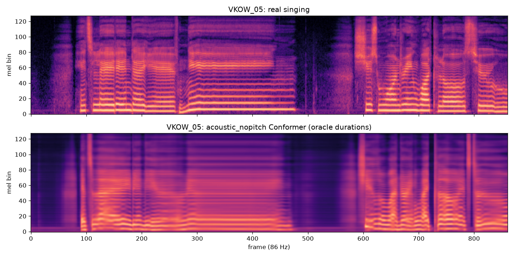 | 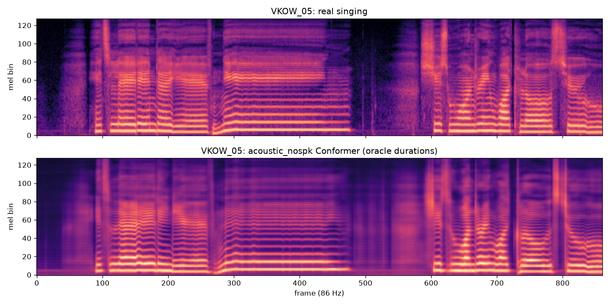 |
| **Hybrid** | 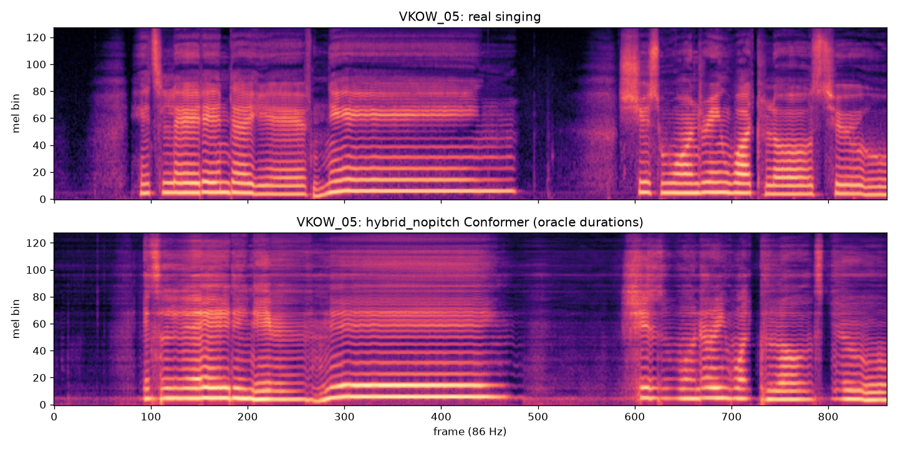 | 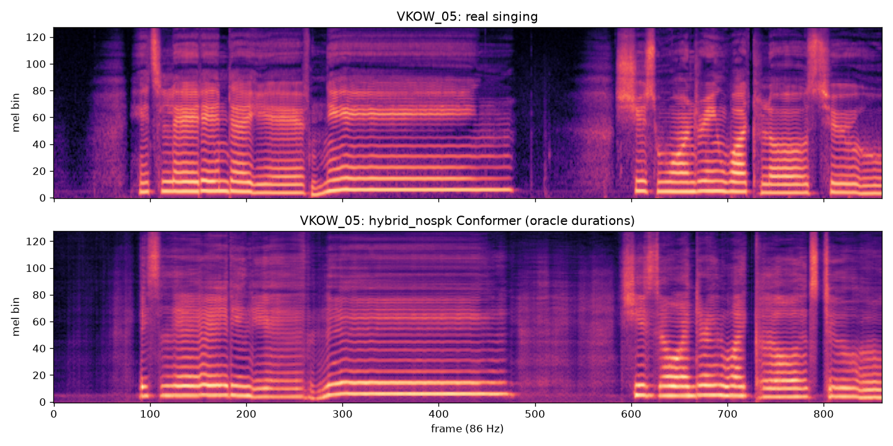 |

- **What it shows:** the same 10 s of VKOW_05 as §15.10 (top: real singing; bottom: the ablated model).
- **Pure, no melody:** the harmonics turn into blurred, nearly flat bands. The model guesses an average
  pitch from the lyrics alone, and the glide around frame 270 disappears. This is the pitch-correlation
  drop to 0.41 in §10.5.
- **Pure, no speaker:** clean harmonic lines that follow the melody, glide included, and sharper than the
  full pure model in §15.10. Removing the unseen speaker's ECAPA embedding helps.
- **Hybrid, no melody:** the harmonics still follow the melody, glide included, because the pitch is already
  in the WORLD input. Clear horizontal WORLD-buzz stripes remain in the pauses and upper bins.
- **Hybrid, no speaker:** crisp harmonics like the full hybrid, still with WORLD's faint buzz in the
  pauses. The lost speaker identity is not visible here; it shows in the speaker score (0.35 → 0.15).

### 15.13 Spectral accuracy vs speaker identity

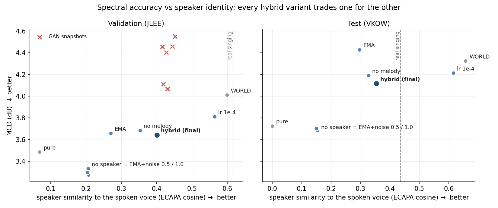

- **What it shows:** every system and hybrid variant as one point, with real durations: speaker similarity to the
  spoken voice (x, right is better) against MCD (y, down is better). Left panel: validation speaker JLEE
  (including the GAN snapshots of §10.6). Right panel: test speaker VKOW. The dashed line is real singing's
  similarity.
- **How to read it:** a variant that beat the final hybrid would sit below and to the right of it. None does.
  The variants spread along a curve from "accurate spectrum, generic voice" (no speaker / speaker noise,
  bottom left) to "speech-like voice, WORLD-like spectrum" (lr 1e-4 next to WORLD, right).
- **The GAN snapshots** (red crosses) sit above the curve: slightly more speaker-like, but clearly worse MCD.
- **Points right of the dashed line** sound more like the *speech* than real singing does. That is not a goal
  in itself (§10.3).
